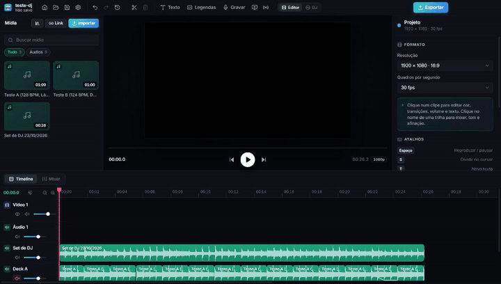
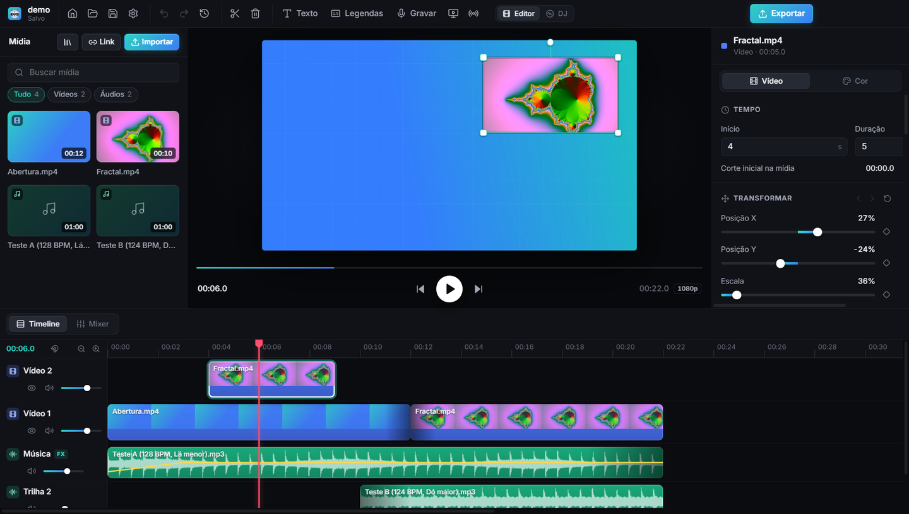
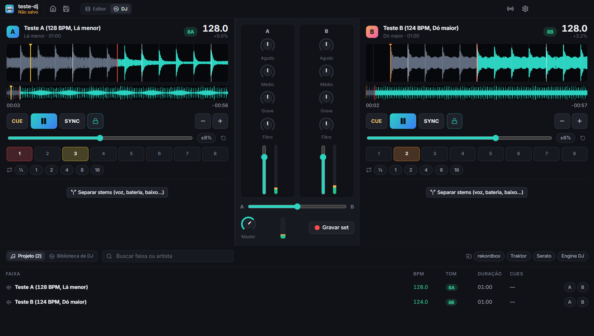
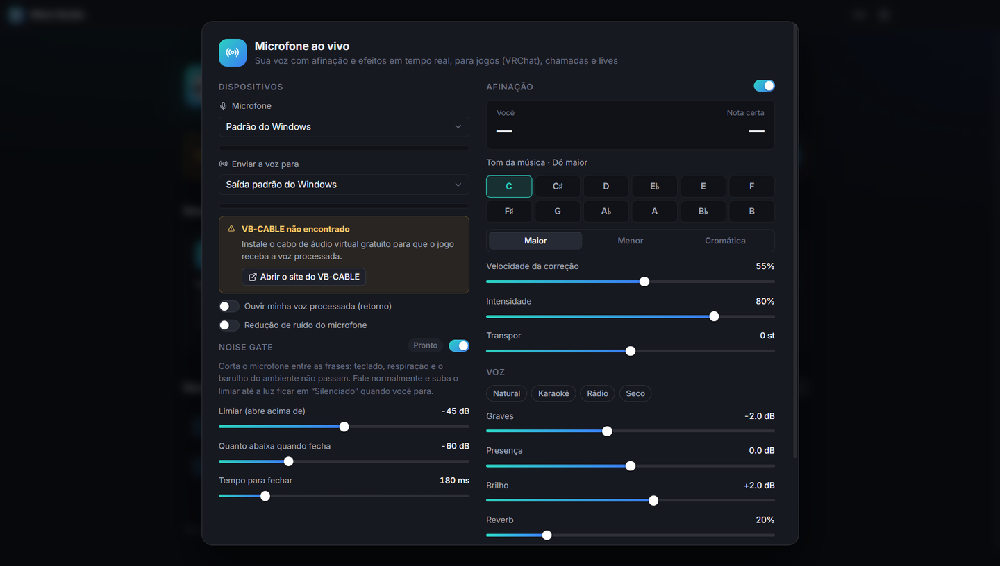
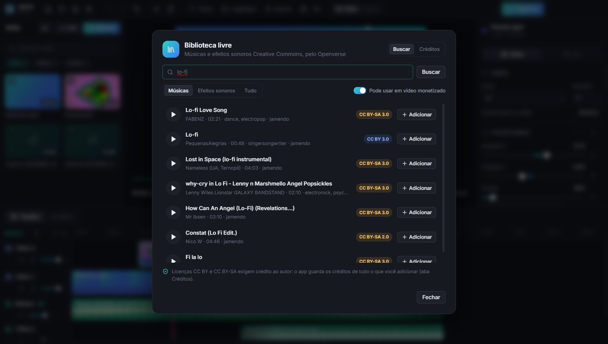
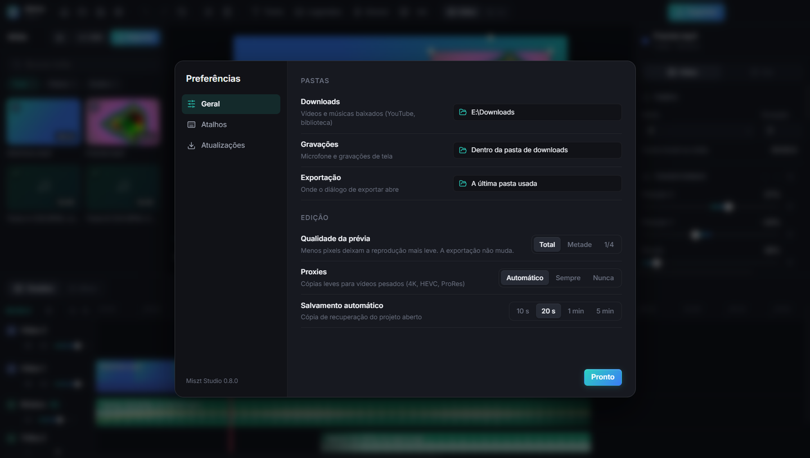

<p align="center">
  
</p>

<h1 align="center">Miszt Studio</h1>

<p align="center">
  Edição de vídeo com áudio de estúdio: timeline multitrilha, mixer, afinação automática,<br />
  separação de voz e instrumentos por IA e exportação profissional.
</p>

<p align="center">
  <strong>Desenvolvido por Miszt</strong> · Windows · Software proprietário
</p>

<p align="center">
  
</p>

---



| Modo DJ | Microfone ao vivo |
|---|---|
|  |  |
| **Biblioteca livre (Creative Commons)** | **Preferências** |
|  |  |

## Recursos

### Edição de vídeo
- Timeline multitrilha com mover, aparar, dividir, snap (inclusive em batidas e marcadores) e zoom.
- **Edição rápida**: excluir fechando o buraco (Shift+Del), timeline magnética, seleção com retângulo, congelar quadro, reverso e rampas de velocidade (Montagem, Herói, Bullet time…).
- Copiar, recortar, colar e duplicar clipes; menu de contexto em clipes, trilhas e mídias.
- **Transições**: dissolver, preto, flash, zoom, deslizar (4 direções) e girar.
- **Efeitos**: desfoque, vinheta, granulado, tremor de câmera e espelhar.
- **Remover fundo com IA** (MODNet na GPU), gerando vídeo com transparência.
- **Transformar na prévia**: arraste para mover, cantos para escalar, alça para girar; corte por lado.
- **Keyframes** de posição, escala, rotação e opacidade, com curvas suave, linear e segurar.
- **Velocidade** de 0,25× a 4× (o tom da voz é preservado).
- Textos com estilos prontos e animações: pop, cair e quicar, máquina de escrever, palavra por palavra e karaokê.
- **Legendas karaokê**: o Whisper marca o tempo de cada palavra e ela acende na hora certa.
- Cor: brilho, contraste, saturação, matiz, sépia, filtros prontos e LUT `.cube`.
- **Legendas automáticas** com Whisper rodando no computador.
- **Pesquisar no YouTube** dentro do app ou **importar de um link** (YouTube e outros sites) com o yt-dlp, escolhendo qualidade e pasta.
- **Gravar a tela** (tela inteira ou janela) com o áudio do sistema e o microfone em trilhas separadas, como no OBS.
- Proxies automáticos para vídeos pesados (HEVC, ProRes, 4K).

### Áudio
- Mixer por trilha: volume, pan, EQ de 3 bandas, compressor, reverb e medidores.
- **Mudar o tom** de −12 a +12 semitons, com assistente "de Si maior para Dó maior".
- **Afinação automática**: tom, escala, velocidade de correção e gráfico de pitch em tempo real.
- **Separar voz e instrumentos** (2, 4 ou 6 faixas) com o Demucs, sob demanda.
- **Separar o áudio do vídeo** em uma trilha própria.
- **Ducking**: a música abaixa sozinha quando há voz.
- **Detecção de batidas** (BPM) com ímã na timeline.
- Automação de volume por pontos e fades.
- **Limpar voz**: remoção de ruído leve, média ou forte, ou ajuste fino (redução, nível do ruído, graves, estalos) com prévia antes/depois.
- **Detecção de tom** com a roda Camelot (ex.: Fá menor · 4A), aplicável na afinação da trilha.
- **Biblioteca livre**: músicas e efeitos sonoros Creative Commons (Openverse), com créditos guardados para a descrição do vídeo.
- **Gravar pelo microfone** com contagem regressiva, tocando a timeline junto.
- **Plugins VST3** (ex.: MAutoPitch) com a interface do próprio plugin, via pedalboard.

### Modo DJ
- Dois decks com BPM e grade de batidas, **SYNC**, trava de tom, 8 hot cues, loops de ½ a 16 batidas e empurrão de andamento.
- Mixer com EQ de 3 bandas (com corte), filtro, faders, crossfader e medidores.
- **Stems ao vivo** (voz, bateria, baixo, outros) por deck, com a separação por IA.
- Mixagem harmônica: tons na roda Camelot e aviso de compatibilidade entre os decks.
- **Importa a sua biblioteca** do rekordbox (XML), Traktor (NML), Serato (tags) e Engine DJ, com BPM, tom, grade e hot cues.
- **Gravar o set** direto para a timeline: áudio exato e/ou clipes editáveis por deck.

### Ao vivo
- **Microfone ao vivo** para VRChat, Discord e lives: afinação em tempo real, noise gate, EQ, compressor e reverb, com saída para o VB-CABLE e retorno nos fones.

### Exportação
- Presets: YouTube 1080p e 4K, Reels/TikTok, arquivo mestre, rascunho, MP3 e WAV.
- MP4 (H.264/H.265), MOV, WebM; resolução, fps e qualidade ajustáveis.
- Normalização de volume para −14 LUFS e estimativa do tamanho do arquivo.
- **Exportação em segundo plano** com fila: continue editando enquanto renderiza.

### Conforto
- Introdução animada na abertura.
- Tela inicial com modelos de projeto (YouTube, Reels/TikTok, quadrado, podcast, clipe musical) e projetos recentes.
- Salvamento automático com recuperação, desfazer/refazer, **histórico visual** (Ctrl+H), marcadores e atalhos J/K/L.
- **Preferências**: pastas, qualidade da prévia, proxies, atalhos personalizáveis.
- **Atualização automática** pelas Releases do GitHub.

## Atalhos principais

| Tecla | Ação |
|---|---|
| Espaço | Reproduzir / pausar |
| J / K / L | Voltar 5 s / pausar / tocar |
| S | Dividir no cursor |
| T | Novo texto |
| M | Marcador no cursor · `[` `]` navegam |
| Ctrl+C / X / V / D | Copiar / recortar / colar / duplicar |
| Ctrl+Z / Ctrl+Y | Desfazer / refazer |
| Ctrl+S / Ctrl+O / Ctrl+E | Salvar / abrir / exportar |
| Ctrl + roda | Zoom da timeline |

## Desenvolvimento

Requisitos: Node.js 22+ e Windows 10/11 (x64). Para separar voz e instrumentos, Python 3.9+.

```bash
npm install
npm run dev
```

Testes (lógica da timeline, afinação, exportação com FFmpeg) e verificação de tipos:

```bash
npm test
npm run typecheck
```

Gerar o instalador (`release/MisztStudio-Setup-<versão>.exe`):

```bash
npm run dist
```

- Use `ELECTRON_BUILDER_CACHE=.cache/electron-builder` para manter o cache do electron-builder no disco do projeto.
- Se a extração do `winCodeSign` falhar por causa de links simbólicos, extraia o `.7z` em `.cache/electron-builder/winCodeSign/winCodeSign-2.6.0` sem a pasta `darwin`.
- O ícone vem de `build/icon.svg`; `npm run icon` gera o `build/icon.png`.

### Estrutura

| Caminho | Conteúdo |
|---|---|
| `electron/main.cjs` | Janela, protocolos `app://` e `media://`, IPC, proxies, autosave |
| `electron/export.cjs` | Timeline → FFmpeg (vídeo, cor, animação, áudio, ducking, loudness) |
| `electron/stems.cjs`, `separate.py` | Separação de faixas com Demucs |
| `electron/downloader.cjs` | Importação por link com yt-dlp |
| `electron/audiotools.cjs`, `vst.py` | Limpeza de voz e plugins VST3 (pedalboard) |
| `electron/djlibrary.cjs` | Leitura das bibliotecas rekordbox, Traktor, Serato e Engine DJ |
| `electron/exportqueue.cjs`, `updater.cjs` | Fila de exportação e atualização automática |
| `src/dj.ts`, `src/components/dj/` | Modo DJ (decks, mixer, gravação do set) |
| `src/live.ts`, `src/dsp/gate.worklet.js` | Microfone ao vivo e noise gate |
| `src/fx.ts` | Transições e efeitos (mesmas fórmulas na exportação) |
| `src/bgremove.worker.ts` | Máscaras de recorte com MODNet |
| `src/engine.ts`, `src/audio.ts` | Prévia: composição no canvas e grafo Web Audio |
| `src/dsp/` | Afinação/transposição e reverb, compartilhados entre prévia e exportação |
| `src/anim.ts`, `src/color.ts`, `src/text.ts` | Mesmas fórmulas na prévia e na exportação |
| `src/components/` | Interface (timeline, inspetor, mixer, diálogos, introdução) |
| `tests/` | Testes automatizados (Vitest) |

## Licença

**Software proprietário. Todos os direitos reservados © 2026 Miszt.**

É proibido copiar, distribuir, modificar, fazer engenharia reversa ou criar obras derivadas sem autorização por escrito. Veja os termos completos em [LICENSE](LICENSE).

Componentes de terceiros mantêm suas próprias licenças; veja [THIRD_PARTY_NOTICES.md](THIRD_PARTY_NOTICES.md).
